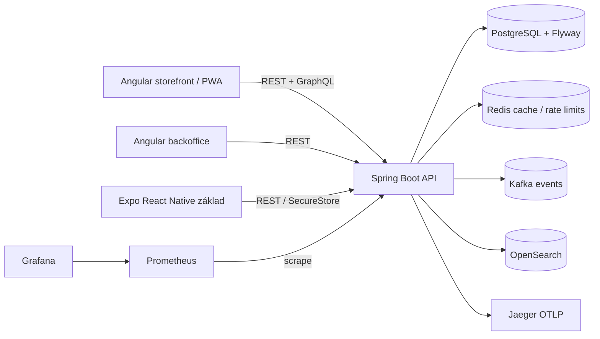

# Artio — technická dokumentace aktuálního stavu

**Stav k:** 13. 10. 2026
> **Aktualizace produktu (2026-10-13):** Tento dokument zachycuje implementaci podle drivejsiho enterprise briefu. Novy zavazny produktovy cil je popsany v `docs/ARCHITECTURE.md`; pri rozporu je tento starsi stav pouze historickym popisem. Aktualni audit, konflikty a dalsi prace jsou v `docs/REPOSITORY_AUDIT.md` a `docs/ROADMAP.md`.
> **Úklid produktového rozsahu (2026-10-13):** Adresáře mobilního Expo klienta, Kubernetes/Istio a Terraform byly odstraněny z repozitáře po ověření, že nemají závislosti z aktivního produktu. Historické popisy těchto modulů níže zachycují stav starší iterace a nejsou současnou podporovanou funkcí. Aktuální nasazení je Docker Compose; současný stav a provedené ověření jsou v `docs/ROADMAP.md` a `docs/REPOSITORY_AUDIT.md`.
> Následující souhrn je aktuální oprava staršího snapshotu; historické sekce dále v dokumentu nepředstavují nynější obsah repozitáře.

## Aktuálně ověřený stav (2026-10-13)

- Gradle registruje 22 modulových projektů. Mobile, Kubernetes/Istio a Terraform adresáře i mobilní convention plugin byly odstraněny; aktuálně popsanou deployment cestou je Docker Compose.
- `/api/v1` je kanonická REST cesta. `/api` zůstává kompatibilní alias. OpenAPI popisuje obě cesty, správné požadavky na bearer autentizaci a API vrací jednotný JSON chybový kontrakt včetně 401/403.
- PostgreSQL Testcontainers ověřil čistou instalaci migrací V1–V15. Upgrade z V9 není podporovaný akceptační cíl: vlastník potvrdil, že žádná externí data neexistovala a zpětná kompatibilita se nevyžaduje. API překlady, extension manifest/registraci/konfiguraci/audit, expirace rezervací a checkout idempotency/tax snapshots mají integrační pokrytí.
- Extension management zahrnuje manifest v1, admin preflight a registraci, persistenci konfigurace podle schématu, AES-GCM šifrování secretů, write-only secret view a append-only audit. Žádný Docker image se z API nespouští; bounded Docker runtime, invocation, health/diagnostics a rollback stále chybí.
- V11 přidává locale-scoped produktové překlady (`de`, `it`, `fr`, `en`) a fallback požadovaný jazyk → angličtina → základní copy. OpenSearch indexuje lokalizované dokumenty; Backoffice nyní umožňuje administrátorovi upravovat překlady názvu a popisu. Admin může spustit replay všech produktů a uložených jazykových překladů do indexu. Operace zatím používá upsert; atomická výměna indexu a úklid osiřelých dokumentů zůstávají otevřené.
- V12 přidává expiraci rezervací a periodické uvolňování v transakci. TTL defaultně 30 minut lze nastavit pomocí `ARTIO_INVENTORY_RESERVATION_TTL`; expirační test prokázal obnovení dostupnosti bez snížení on-hand. Dvě souběžné rezervace quantity 3 proti zásobě 5 prokázaly bezpřeprodejní řádkový zámek. Před vytvořením Stripe Checkout session se platné rezervace prodlouží pod zámkem skladu na 32 minut od požadavku; Stripe session expiruje po 31 minutách. Scheduler následně zruší dosud PENDING objednávky až tehdy, když všechny jejich rezervace vypršely a jsou RELEASED; související pending platby označí FAILED. Webhook a reconciliation scheduler se serializují zámkem objednávky.
- V13 ukládá ke každé objednávce checkout country/market/jurisdikci a verziovaný JSON tax snapshot s jednotlivými quote řádky, sazbou a efektivním obdobím. U historických záznamů se původní částky nemění a provenance je označena jako neznámá.
- V14 vynucuje unikátní checkout idempotency key per uživatel. Stejný klíč vrací původní objednávku; storefront jej zachovává při opakování a Stripe Checkout volání používá stabilní klíč odvozený od order ID.
- V15 přidává registrované pluginy a append-only audit. Veřejná konfigurace se ukládá jako JSONB; secret hodnoty se ukládají pouze šifrované a API vrací jen názvy nastavených secretů. API integrační test ověřil i zachování dřívějšího secretu při jeho vynechání v dalším PUT.
- Checkout objednávkový tax snapshot nyní uchovává konfiguraci bundle: zvolené možnosti, vyřešené komponenty, množství, nakonfigurovanou cenu, korekční faktor a trh/jurisdikci. Implementace této změny ještě čeká na cílené ověření.
- P1-02 je uzavřen jako „closed – not applicable“: vlastník potvrdil, že nikdy neexistovala produkční ani externí data. V10 je určena pro čistou instalaci bez tenant modelu; kompatibilita se staršími databázemi se nepožaduje.
- P1-07: API již nemá výchozí databázové heslo ani JWT/šifrovací klíče. Compose vyžaduje tyto hodnoty, spouští profil `production` a API odmítá krátké nebo zástupné kryptografické klíče. Nové validační unit testy a API Testcontainers integrační testy prošly; ukázkové hodnoty jsou v `.env.example` a musejí být nahrazeny před spuštěním.

**Větev / commit:** `main` / lokální změny budou commitnuté bez pushnutí.
**Účel:** popis skutečně přítomné architektury, rozhraní, provozu a omezení. Tento dokument není roadmapa ani tvrzení o certifikované produkční připravenosti.

## 1. Přehled

Artio je commerce aplikace organizovaná jako **modulární monolit**. Samostatné Gradle moduly obsahují doménové modely, PostgreSQL adaptéry, REST aplikaci a dvě Angular aplikace. V této iteraci přibyly vybrané enterprise funkce: MFA TOTP, šifrování tajemství, auditní metadata, GraphQL čtení katalogu, realtime stav objednávek, privacy export a anonymizace, souhlasy, gift cards, loyalty, měnové kurzy, doporučení založená na popularitě, pravidlové fraud review, správu subscription záznamů, PWA shell, React Native / Expo základ, tracing a monitoring.

Základní obchodní cesta zůstává REST API → PostgreSQL. Stripe potvrzuje platbu přes webhook. Rezervace skladu, uživatelská oznámení a přenos událostí do Kafka jsou součástí aplikace. Databáze používá single-install model bez `tenant_id`; autorizace vychází z rolí a vlastnictví konkrétních zdrojů.



## 2. Technologie a sestavení

| Oblast | Aktuální volba |
|---|---|
| Backend | Java 21, Spring Boot 3.3.5, Spring MVC, Spring Security, JDBC |
| Build backendu | Gradle 8.10.2 wrapper, Kotlin DSL, `buildSrc` convention plugins |
| Databáze | PostgreSQL 16, Flyway migrace |
| Cache / rate limiting | Redis 7.4, lokální fallback limiter |
| Event broker | Kafka 3.8, lokální Compose režim KRaft |
| Search | OpenSearch 2.17; adaptér lze vypnout konfigurací |
| Web | Angular 17, TypeScript strict, npm lockfiles |
| Mobile základ | Expo SDK 57 / React Native 0.86 / React 19.2, SecureStore |
| Observability | Actuator, Micrometer Prometheus, OpenTelemetry OTLP, Jaeger |
| Nasazení | Docker Compose, Kubernetes/Kustomize, Istio ukázkové manifesty, Terraform pro API |

Použitelné příkazy:

```powershell
cd D:\Development\Projects\Artio
.\gradlew.bat clean build
.\gradlew.bat integrationTest
docker compose -f artio-docker\docker-compose.yml config --quiet
kubectl kustomize artio-kubernetes
```

`build` sestavuje Java části, storefront i backoffice; nově také spouští `npm ci` a TypeScript typecheck mobilní aplikace. `integrationTest` používá Testcontainers a vyžaduje dostupný Docker daemon. Lokální build sám o sobě neprovádí build image ani Kubernetes deploy.

Gradle konvence v `buildSrc`:

- `artio.java-library` — společná Java konfigurace, testy, JaCoCo a lintovací kontroly.
- `artio.spring-boot-app` — Spring Boot aplikace, Actuator a metriky.
- `artio.integration-test` — samostatná integration-test konfigurace pro Testcontainers.
- `artio.domain-module` — doménové moduly.
- `artio.frontend-module` — zamčené Angular buildy.
- `artio.mobile-app` — instalace zamčených Expo závislostí a TypeScript typecheck.

## 3. Repo struktura a odpovědnosti

| Cesta | Obsah |
|---|---|
| `artio-kernel` | Value objects, `Money`, `Quantity`, `Percentage`, invarianty a `Result`. |
| `artio-catalog` | Katalogové domény, produkt, varianta, metadata, události a repository porty. |
| `artio-catalog-postgres` | PostgreSQL katalog/taxonomie migrace V1–V2 a adaptéry. |
| `artio-catalog-opensearch` | Vyhledávací adaptér pro OpenSearch. |
| `artio-pricing`, `artio-pricing-postgres` | Cenová pravidla, slevy, daňová pravidla, výpočet quote a DB adaptéry. |
| `artio-inventory`, `artio-inventory-postgres` | Sklady, stock levels, rezervace, alokace, uvolnění. |
| `artio-bundles`, `artio-bundles-postgres` | Bundle aggregate, konfigurační pravidla, quote a persistence. |
| `artio-orders` | Košík, objednávka, řádkové položky a statusy. |
| `artio-users` | User a role doména. |
| `artio-payments` | Platební modely a statusy; provider adapter je Stripe v REST aplikaci. |
| `artio-notifications` | Model oznámení. |
| `artio-events` | Abstrakce event bus/store a serializace. |
| `artio-persistence` | Transakční/repository rozhraní. |
| `artio-observability` | Jednoduché interní log/trace/metrics abstrakce. |
| `artio-rest-api` | Spring Boot runtime, REST a GraphQL controllery, security, WebSocket, Flyway V6–V10. |
| `artio-storefront` | Angular storefront, košík, produkty, bundle, checkout, consent a PWA shell. |
| `artio-backoffice` | Angular administrační rozhraní. |
| `artio-mobile` | Expo startovní aplikace, API klient a secure token storage. |
| `artio-docker` | Compose stack, Dockerfiles a společný Nginx reverse proxy. |
| `artio-kubernetes` | API/frontends/ingress, Kustomize a volitelné observability/Istio konfigurace. |
| `artio-observability` | Prometheus scrape/alert pravidla a Grafana provisioning/dashboard. |
| `terraform` | Terraform konfigurace namespace, API deployment/service/HPA. |

## 4. Doménová architektura a data

API koordinuje workflow přímo přes moduly v jednom Spring procesu; hranice modulů nejsou nezávislé deploy jednotky. Události se používají pro vybrané asynchronní integrace, ale každá interakce mezi doménami nejde přes Kafka. PostgreSQL zůstává společná databáze.

Flyway schema registry obsahuje migrace V1–V10 rozdělené mezi adapter moduly a REST API:

1. V1: produkty a varianty.
2. V2: značky, kategorie a atributy katalogu.
3. V3: ceny, slevy a daňová pravidla.
4. V4: sklady, skladové zásoby a rezervace.
5. V5: bundle, volby a konfigurace.
6. V6: uživatelé, košíky a objednávky.
7. V7: platby a in-app oznámení.
8. V8: tracking zásilky.
9. V9: konfigurované bundle řádky v košíku/objednávce.
10. V10: MFA metody, append-only audit metadata, souhlasy, gift cards a transakce, loyalty, směnné kurzy, produktové interakce, fraud review a subscriptions. Tenant tabulky ani tenant sloupce nevznikají.

MFA TOTP secret je v DB uložen jako AES-GCM ciphertext. Záložní kódy jsou uloženy pouze jako BCrypt hashe. Gift card kód je klientovi vrácen pouze při vydání; v DB je jeho SHA-256 hash. Audit tabulka uchovává metadata requestu, ne těla requestů ani snapshot změn. Trigger blokuje update a delete auditních řádků.

## 5. HTTP a aplikační rozhraní

Všechny JSON API běží pod `/api`, GraphQL pod `/graphql`, realtime STOMP/WebSocket handshake pod `/ws`.

### Identity a security

- `POST /api/auth/register`, `POST /api/auth/login` — registrace zákazníka a HS256 access JWT (1 hodina). Login s MFA očekává nepovinné `mfaCode`; při zapnutém MFA je vyžadován TOTP nebo nepoužitý záložní kód.
- `POST /api/auth/mfa/totp/enrollment` — zahájí enrolment a vrátí TOTP secret + `otpauth://` URI.
- `POST /api/auth/mfa/totp/verify` — ověří TOTP a vrátí sadu jednorázových backup kódů pouze jednou.
- `DELETE /api/auth/mfa/totp` — MFA deaktivuje po ověření aktuálního TOTP.
- `GET /api/users/me`, `GET /api/admin/users` — profil a seznam uživatelů pro samostatnou instalaci.
- `GET /api/admin/audit-logs` — audit metadata s filtry `userId`, `action`, `from`, `to`, `page`, `size`.
- Rate limit: default 100 requestů/minutu/IP, Redis s lokálním fallbackem; `X-API-Key` dostává samostatný vyšší limit, ale samotný klíč zde nenahrazuje autentizaci.

### Katalog a GraphQL

REST katalogové cesty viz `README.md` a controllery v `artio-rest-api/.../catalog`. GraphQL je zatím **read-only**:

```graphql
query Catalog($q: String, $first: Int) {
  products(search: $q, first: $first) {
    id name description sku active
    variants { id name sku active }
  }
}
```

`first` je omezen na 1–100, search text na 200 znaků; query vrací pouze aktivní produkty a varianty. Zápis zůstává na REST endpointu s role kontrolou. DataFetchery nyní čtou legacy katalogové tabulky, které nejsou tenant scoped.

### Obchodní funkce nové iterace

- `POST /api/privacy/consent`, `GET /api/privacy/consent` — zaznamená a načte poslední authenticated-user preference.
- `GET /api/privacy/export` — JSON export profilu, objednávek, řádků, oznámení, consentů a loyalty stavu.
- `DELETE /api/privacy/account` — zneplatní účet, anonymizuje identitu a rediguje adresy; transakční záznamy objednávek zůstávají.
- `POST /api/admin/gift-cards`, `POST /api/gift-cards/redeem` — vydání a atomické odečtení zůstatku gift card. Redemption je samostatná operace; checkout a refund workflow ho zatím nepoužívá.
- `GET /api/loyalty/me`, `POST /api/loyalty/earn/{orderId}`, `POST /api/loyalty/redeem` — account, připsání po zaplacené objednávce, výběr bodů v násobcích 100.
- `POST /api/interactions`, `GET /api/recommendations?limit=10` — customer může logovat `VIEW` a `CART`; recommendation query řadí agregovanou popularitu košíků/nákupů. Není to ML inference.
- `POST /api/admin/orders/{orderId}/fraud-assessment` — transparentní pravidlové skóre, signály `high_order_value`, `order_velocity`, `new_account`, `express_shipping`; výsledek uloží `ALLOW`, `REVIEW` nebo `HOLD`. Nepřepíná automaticky status objednávky.
- `GET /api/currency/convert?amount=...&from=...&to=...`; admin vkládá rate přes `POST /api/admin/currency/rates`. Není připojen externí FX provider ani automatický scheduler.
- `GET /api/subscriptions`, `POST /api/admin/subscriptions`, `PUT /api/subscriptions/{id}/status` — záznamy recurring subscriptions a změna statusu. Periodické inkaso, vault payment method a generování objednávek nejsou zapojené.

### Realtime objednávky

STOMP connect na `/ws` musí obsahovat `Authorization: Bearer <JWT>`. Klient odebírá pouze `/user/queue/orders/{orderId}` a odešle `/app/orders/{orderId}/subscribe`; backend ověřuje vlastnictví objednávky. Stavový snapshot i změny PAID/SHIPPED/DELIVERED/CANCELLED se posílají na privátní user queue. Použitý Spring simple broker je pouze procesní; pro více replik se musí nahradit externím STOMP broker relay / event fan-outem. Produkty, ceny a stock zatím realtime stream nemají.

## 6. Bezpečnostní pravidla a ochrana dat

- REST API používá stateless Bearer JWT, role `CUSTOMER`, `ADMIN`, `SUPERADMIN`; role je claim tokenu, takže změna role se projeví po expiraci/obnově tokenu.
- Hesla jsou BCrypt; registrace vynucuje 12–72 znaků, bootstrap superadmin 16+.
- TOTP implementuje RFC 6238, 30s okno a tolerance ±1 krok. Backup kód lze použít pouze jednou.
- `ARTIO_ENCRYPTION_KEY` má mít nejméně 32 bajtů; AES key se odvodí SHA-256. MFA secret používá AES/GCM/NoPadding, 96-bit random IV a 128-bit auth tag. Změna klíče bez migračního/rotation workflow znepřístupní dřívější ciphertext.
- Produkční profile odmítne známé výchozí JWT/encryption secrets. Compose však záměrně poskytuje pouze lokální placeholdery; `.env` musí mít nové náhodné klíče.
- CORS je allowlist přes `ARTIO_ALLOWED_ORIGINS`. Nginx a API přidávají CSP, `X-Content-Type-Options`, `X-Frame-Options`, referrer a permissions policy; HSTS je nastaven na Kubernetes ingressu a API respektuje forwarded proto.
- Audit zapisuje metodu, cestu, status, actor UUID, IP a User-Agent; nepíše body ani hesla/tokeny. Auditní obsah (metadata) není šifrovaný; append-only trigger brání editaci/mazání, proto není nastavená automatická retenční purge.
- PWA cache neukládá `/api`, `/graphql` ani `/actuator`; offline fallback výslovně upozorňuje, že účet, košík a checkout potřebují připojení.
- `X-Forwarded-For` není audit filtrem důvěřován; IP je `getRemoteAddr()`. Pro správnou IP za proxy je třeba řídit trusted-proxy konfiguraci v deploymentu.

## 7. Frontendy

### Angular storefront

Storefront obsahuje katalogové prohlížení/hledání, varianty, registraci/login (včetně MFA kódu), košík, konfiguraci bundle, checkout přes Stripe-hosted session a přehled objednávek. PWA soubory jsou v `artio-storefront/src/manifest.webmanifest`, `src/sw.js`, `src/offline.html`. Service worker se registruje jen v production build režimu. Ukládá shell a statické assety; API ani autentizované odpovědi necachuje.

EN/CS/DE `LocaleService` překládá navigaci, login doplněk a cookie panel. Zbytek UI nemá dokončenou lokalizaci; locale není server-side preferencí účtu a chybí kompletní pluralizace/number/date format.

Cookie panel ukládá nezbytné/analytics/marketing preference lokálně. Po přihlášení odešle preference na API; anonymous consent zatím není serverově persistován. Analytics/marketing tagy nejsou zavedené.

### Angular backoffice

Backoffice poskytuje základní správu produktů/variant, bundle, ceny, uživatelů, reportů a expedice. Není to plně vybavený ERP panel: interaktivní warehouse stock management, subscriptions/gift cards/loyalty/audit/fraud obrazovky, analytické grafy a kompletní lokalizace chybí.

### Expo mobile

`artio-mobile` je typově kontrolovaný startovní klient: login/MFA pole, katalog, přidání produktu do košíku, přehled košíku a objednávek, SecureStore pro access token. Expo SDK 57 cílí React Native 0.86 a React 19.2; lokální Node je vyžadováno alespoň 22.13 podle dokumentace Expo. Před spuštěním nastavte `EXPO_PUBLIC_API_URL` na dosažitelnou API URL; `localhost` z telefonu neukazuje na vývojový počítač. Push tokeny, push provider, registrace, detail produktu, checkout, bundle UI, navigační framework, iOS/Android build a store signing nejsou dokončené. [Expo SDK reference](https://docs.expo.dev/versions/latest/).

## 8. Observability a nasazení

### Compose

`artio-docker/docker-compose.yml` obsahuje PostgreSQL, Redis, Kafka, OpenSearch, REST API, oba weby, Jaeger OTLP, Prometheus a Grafanu. UI adresy a lokální credentials jsou v `README.md`; Grafana je `localhost:3000`, Prometheus `localhost:9090`, Jaeger `localhost:16686`. Prometheus scrapeuje `/actuator/prometheus`, alerty jsou v `artio-observability/prometheus/alerts.yml`, dashboard a datasource provisioning jsou v `artio-observability/grafana/provisioning`.

Jaeger export používá OTLP HTTP (default `http://localhost:4318/v1/traces`, Compose override `http://jaeger:4318/v1/traces`), sampling default 10 %. Pro produkci nastavte tracing collector, sampling a retenci podle kapacity a privacy požadavků.

### Kubernetes, Istio, Terraform

- `artio-kubernetes` nasazuje API/frontends/Ingress; PostgreSQL, Redis, Kafka, OpenSearch, Jaeger a `artio-secrets` musí být předem připraveny jako externí/managed služby. Domény, TLS secret, image registry a secret hodnoty jsou placeholders.
- `artio-kubernetes/observability.yaml` je volitelné Prometheus Operator `ServiceMonitor` + `PrometheusRule`; cluster musí mít odpovídající CRD. Základní Kustomize config ho nenasazuje automaticky.
- `artio-kubernetes/istio` obsahuje ukázkové VirtualService a DestinationRule. Subset `v2` není připojen k existujícím deploymentu; před canary vážením je třeba skutečný v2 Deployment označit `version: v2`.
- `terraform/` provisionuje namespace, API deployment/service/HPA a ConfigMap v existujícím clusteru. Neposkytuje Postgres/Redis/Kafka/OpenSearch, ingress, Jaeger ani frontendové resources. Terraform apply ani cluster deploy zde nebyly provedeny.
- `artio-docker/nginx.conf` proxyuje `/api`, `/graphql` a `/ws`, nastavuje websocket upgrade a browser bezpečnostní hlavičky.

## 9. Iterace 15–30: stav podle briefu

| Fáze | Aktuální stav | Zbývající práce |
|---|---|---|
| 15 — Security | TOTP MFA, jednorázové backup hashes, AES-GCM pro MFA secret, request audit metadata, CORS allowlist, security headers, existing JWT roles/rate limiter. | Volitelné Google OIDC přihlášení s provisioningem/napojením pouze přes ověřený email je implementováno v profile `oauth2`; chybí Facebook/GitHub/Apple, recovery flow, obnova/rotace klíčů, šifrování dalších osobních polí a state snapshots, audit export/signature, WAF/DDoS proxy integrations, threat/security tests. |
| 16 — Performance | Read-only katalog GraphQL, static PWA shell a offline fallback, authenticated realtime order STOMP stream. | CDN/S3 image adapter, Angular SSR/SEO/prerender, bezpečný offline cart/background sync, produktové/cenové/stock realtime, multi-instance broker relay, query complexity/persisted GraphQL queries a výkonové testy. |
| 17 — AI/ML | Hybridní směr není vybudován; nyní popularity-based recommendations a vysvětlitelné pravidlové fraud score + persist review. | Trénované/validované modely, collaborative/content filtering, feature pipeline, inference/monitoring/bias controls, price elasticity/demand forecasts/competitor feed a lidské schválení optimalizace. |
| 18 — Multi-tenancy | Out of scope. Owner decision confirms one independently deployed installation per customer; tenant schema, runtime context, API routes, and JWT claims are removed. | No tenant-specific follow-up. |
| 19 — Mobile | Expo/React Native app skeleton + secure bearer token, login/MFA entry, catalog/cart/orders. | Completní obrazovky, router/state layer, registration, checkout/payments, push token registration/provider, deep links, tests, native builds/signing/App Store/Play Store. |
| 20 — I18N | Omezené EN/CS/DE stringy na storefront navigaci/privacy/login. Manuální FX tabulka/conversion endpoint; checkout tax dál používá stávající pricing tax rules. | Kompletní frontend/backend i18n, locale-aware SEO/formaty, externí FX feed, pricing conversion end-to-end, installation currencies, VAT reverse charge, region/country product tax categories a právně validovaná tax integrace. |
| 21 — Advanced commerce | Gift card issuance/hash/atomic redemption; loyalty accounts, dedupe points earned for paid orders, redeem ledger; subscription CRUD/status/frequency. | Gift card jako checkout tender/refund/audit UI; loyalty tiers/spend thresholds/expiry/payment undo; robust billing scheduler, payment method vault/Stripe subscription lifecycle, order creation, retry/dunning a customer portal. |
| 22 — Analytics | Existing admin summaries/order status, top variants a průměrné lifetime revenue/customer (CLV approximation); Prometheus runtime metrics/dashboard pro API. | Real-time business event pipeline, cohort CLV, retention/conversion funnels, inventory turnover, discount analysis, multi-currency normalized revenue a dashboard UI. |
| 23 — Compliance | User JSON export, account anonymization + address redaction, lokální consent preference UI a server snapshot po loginu, API audit log. | Complete GDPR subject mapping/retention schedule/legal holds, portable assets/billing data, consent for anonymous users, revocation propagation, CCPA workflows, DPA/consent evidence review, legal/privacy validation and automated tests. |
| 24 — Service mesh | Istio VirtualService/DR ukázka s retry/timeout/pool. | Instalace Istio, telemetry/policies/mTLS, skutečné v2 deploymenty, test canary a rollback. |
| 25 — Tracing | Micrometer/OpenTelemetry OTLP export do lokálního Jaegeru. | Trace propagation do async Kafka/event handlers, redaction/privacy sampling review, collector/high availability a korelace alertů. |
| 26 — IaC | Terraform pro API workload v již existujícím Kubernetes. | Cloud-specific cluster/managed database/cache/broker/search, networking, secrets manager, ingress/TLS, backups and disaster recovery. |
| 27 — Monitoring | Prometheus scrape, alert rules, Grafana datasource/dashboard provisioning, optional ServiceMonitor. | Production Prometheus Operator/Alertmanager receivers, SLO burn alerts, business metrics, tested alert routing/on-call. |
| 28–30 | Brief neobsahuje konkrétní detailní implementační specifikace nad oblastmi výše. | Release/capacity/DR/chaos/compliance processes musí mít samostatný návrh a cíle před označením jako hotové. |

Tabulka je záměrně přesná: existence endpointu nebo manifestu neznamená, že daná funkce je end-to-end integrována nebo produkčně připravena.

## 10. Ověření a limity

Po této iteraci je nutné ověřit zejména:

1. `gradlew clean build` prošel v této iteraci, včetně kompilace modulů, unit testů, backendu, Angular storefront production build a mobilního TypeScript typecheck.
2. TOTP RFC 6238 a AES-GCM round-trip/tamper testy prošly; ostatní existující unit testy v build graphu také prošly.
3. Storefront production build prošel. Backoffice npm build byl up-to-date a Gradle jej znovu provedl jen pokud bylo potřeba. Expo typecheck prošel jako součást Gradle buildu.
4. `docker compose -f artio-docker/docker-compose.yml config --quiet` prošel; `kubectl kustomize artio-kubernetes` prošel. Terraform CLI není nainstalován, proto jeho `fmt`/`validate` nebylo možné spustit.
5. Čistá instalace Flyway V1–V15 a API integrační testy jsou ověřovány přes Docker Testcontainers. Starší externí databáze nejsou podporovaným migračním cílem podle konečného rozhodnutí vlastníka.

Provozní omezení: Compose používá vývojová hesla PostgreSQL a výchozí lokální klíče, single-node Kafka, cache a broker. Nejde o HA produkční topologii. Stripe credentials/webhook, SMTP TLS, secrets, cluster external dependencies, TLS domains, images, backup policy, monitoring receivers, Grafana admin credentials a API origin allowlist musí provozovatel nastavit před reálným nasazením. Nejsou zde tvrzeny load tests, pen-test, coverage nad 80 %, GDPR/PCI certifikace ani deployment do cloudu.
