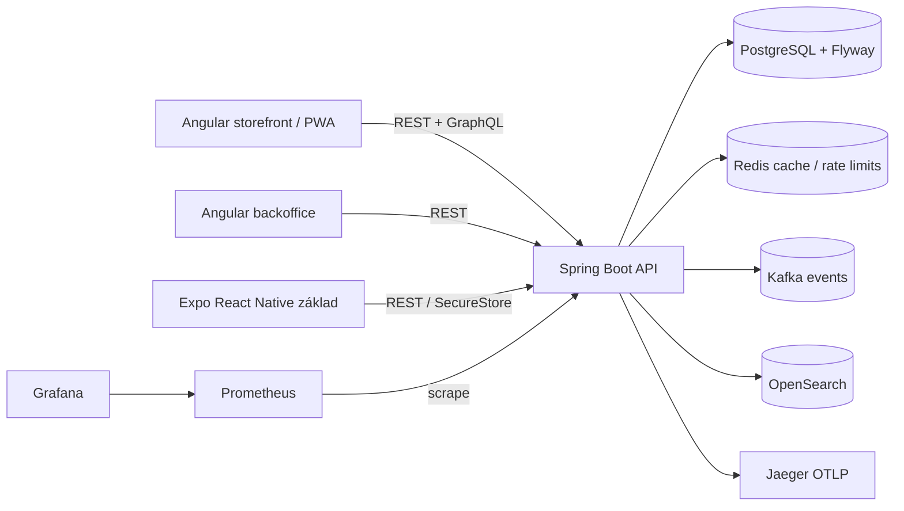

# Artio — technická dokumentace aktuálního stavu

**Aktualizováno:** 15. 10. 2026
> **Aktualizace produktu (2026-10-13):** Tento dokument zachycuje implementaci podle drivejsiho enterprise briefu. Novy zavazny produktovy cil je popsany v `docs/ARCHITECTURE.md`; pri rozporu je tento starsi stav pouze historickym popisem. Aktualni audit, konflikty a dalsi prace jsou v `docs/REPOSITORY_AUDIT.md` a `docs/ROADMAP.md`.
> **Úklid produktového rozsahu (2026-10-13):** Adresáře mobilního Expo klienta, Kubernetes/Istio a Terraform byly odstraněny z repozitáře po ověření, že nemají závislosti z aktivního produktu. Historické popisy těchto modulů níže zachycují stav starší iterace a nejsou současnou podporovanou funkcí. Aktuální nasazení je Docker Compose; současný stav a provedené ověření jsou v `docs/ROADMAP.md` a `docs/REPOSITORY_AUDIT.md`.
> Následující souhrn je aktuální oprava staršího snapshotu; historické sekce dále v dokumentu nepředstavují nynější obsah repozitáře.

## Aktuálně ověřený stav (2026-10-15)

- **Docker lifecycle ověřen 2026-10-15:** `scripts/verify-extension-runtime.ps1` prošel se dvěma skutečnými Docker testy bez přeskočení. Ověřena instalace/volání/update/rollback/uninstall jednoho kontejneru i bundle, timeout bez ztráty health, restart sidecaru, omezení prostředků a UID, zachování persistentních dat a úklid spravovaných kontejnerů/volumes. Testovací porty jsou pouze loopback pod konstruktorovým test flagem; produkční síťová politika se nemění. Zabalený controller a provider sandboxy zůstávají samostatnou další akceptací.

- **Aktuální technologický základ:** Java 25 LTS, Gradle 9.8.1, Spring Boot 4.1.1, Angular 22, TypeScript 6 a Node.js 24 LTS. CI, Gradle toolchain i digest-pinned API build/runtime images používají Java 25; frontend dependency graph už přímo neinstaluje nepoužívané `@angular/animations`.
- **Nejnovější brána:** `gradlew.bat build integrationTest --init-script build/continuation-output.init.gradle --no-daemon` prošla na Java 25 / Gradle 9.8.1 za 3 minuty 40 sekund (134 úloh). Všechny API unit testy a 91 PostgreSQL/Kafka API integračních scénářů prošly (86 úspěšných, pět opt-in Docker fixture scénářů přeskočeno); OpenSearch integrace, kontrola hranic modulů, Java buildy a produkční buildy Storefrontu (417.50 kB) a Backoffice (699.40 kB, pod limitem 700 kB) také prošly. API a extension-controller Docker build prošel; Trivy nenašel žádné HIGH/CRITICAL OS ani knihovní nálezy v API/runtime JAR. Testcontainers odstranil jeden vytvořený kontejner a image; žádné volumes nezůstaly. P9 nyní ověřuje obnovu outboxu a oznámení po opuštěných claimech, consumer-group rejoin po rebalance i PostgreSQL outage/recovery bez dead-letteru. Immutable search/notification image release zůstává v P12.
- **P10 pokračuje:** Struktura katalogu i hlavní produktový katalog Backoffice nyní používají EN/DE/IT/FR, včetně prázdných stavů a přístupných popisků filtrů. Katalog se stahuje až při otevření a má samostatný 25.68 kB chunk; úvodní produkční balík je pod limitem 700 kB (694.27 kB). Vitest ověřuje oba katalogové pohledy napříč čtyřmi jazyky (13/13 testů); `npm test` je součástí Gradle `check`. Po změně prošla celá root brána `build integrationTest` (135 úloh).
- **Docker lifecycle ověřen 2026-10-15:** `scripts/verify-extension-runtime.ps1` prošel se dvěma skutečnými Docker testy bez přeskočení. Ověřena instalace/volání/update/rollback/uninstall jednoho kontejneru i bundle, timeout bez ztráty health, restart sidecaru, omezení prostředků a UID, zachování persistentních dat a úklid spravovaných kontejnerů/volumes. Testovací porty jsou pouze loopback pod konstruktorovým test flagem; produkční síťová politika se nemění. Zabalený controller a provider sandboxy zůstávají samostatnou další akceptací.

- Pokračovací audit začal na HEAD `6b937c6`: čistý `main`, remote `dvoracek-martin/artio`, Docker Engine 29.8.2 dostupný. Testcontainers 1.21.4 umožnil skutečné PostgreSQL/Kafka běhy. P2-09a doplňuje rotaci šifrovaných Kafka dead-letter payloadů do stejné transakce jako MFA a plugin secrets; PostgreSQL ověřil oprávnění, čitelnost novým klíčem, idempotenci i rollback při poškozeném ciphertextu. 89 API unit testů prošlo. Opakovaná katalogová sada s izolovanými reporty má 51 scénářů: 45 prošlo, 6 selhalo, žádný přeskočen. Celá fáze není dokončena; zbývající chyby a přesné příkazy jsou v `docs/ROADMAP.md`. Souběžné externí commity a změny nejsou součástí tohoto zásahu.

Tento souhrn je autoritativní pro současný checkout; následující původní technická dokumentace z 13. 10. 2026 je historický snapshot a v případě rozporu nepopisuje dnešní stav.

- Repozitář má 19 Gradle projektů: 16 Java modulů, Backoffice, volitelný Storefront a Docker packaging. `artio-mobile`, `artio-kubernetes` a `terraform` byly odstraněny. Java moduly `artio-persistence` a `artio-events` a nepoužívaná Java vrstva observability byly odstraněny; samostatný Docker plugin bundle `artio-plugins/observability` obsahuje Grafana/Prometheus/Jaeger/OTLP collector zdroje a spravuje jej Plugin Manager. `artio-docker/observability` je lokální Compose cesta.
- Historický stack: Java 21 / Gradle 8.10.2 / Spring Boot 3.3.5 a Angular 17. Nynější podporovaný základ je výše uvedený Java 25 / Gradle 9.8.1 / Spring Boot 4.1.1 / Angular 22. Compose je podporovaný standardní runtime. Root `docker compose up -d` spouští PostgreSQL, Kafka, REST API, event-worker, extension-controller a Backoffice; Storefront je samostatný volitelný profil. `Start-Artio.cmd` nyní aktivuje také Storefront profil a otevře oba frontendy (Backoffice `4201`, Storefront `4200`). `Stop-Artio.cmd` zastaví kontejnery bez smazání persistentních volumes.
- První spuštění generuje tajné hodnoty do persistentního secret volume; instalační wizard založí první SUPERADMIN a nastavení obchodu/regionu/jazyků. Setup gate blokuje obchodní API do dokončení instalace. `dev` profile je oddělený od produkčního režimu a nesnižuje autorizaci.
- Regionální katalog nyní načítá startup-validované JSON distribuce; `switzerland-v1` je veřejně dostupná přes `/api/v1/public/distributions` a obsahuje CH/CHF/de-CH, de/fr/it/en a `Europe/Zurich` a volitelná ID Stripe/Swiss Post pluginů. Distribuce zatím nezajišťuje instalaci pluginů; publikované image a jejich ověřené digesty neexistují.
- Backoffice Plugin Manager nabízí regionální discovery katalog přes `/api/v1/admin/extensions/catalog`; zobrazuje popis, oblast, extension point a lifecycle registrovaných důvěryhodných vydání. Nezaregistrovaná doporučení zůstávají viditelná jako `WAITING_FOR_RELEASE` a nelze je instalovat bez skutečného digest-pinned manifestu. Odinstalovaný plugin lze z katalogu obnovit do `VALIDATED`; jeho secrets zůstávají smazané a kontejnery se znovu nespustí automaticky. `RegionalDistributionCatalogTests` prošel; cílený integrační test byl spuštěn, ale Testcontainers scénář byl přeskočen kvůli nedostupnému Dockeru. Backoffice build prošel. Kontrakt: `docs/extensions/plugin-manifest-v1.md`.
- Varianty katalogu podporují až 50 hodnot možností navázaných na aktivní typované atributy. `POST /api/v1/products/{id}/variants` vytváří a `PUT /api/v1/variants/{id}` upravuje kombinaci; text, číslo a boolean procházejí typovou validací. Složená neprázdná kombinace je unikátní v rámci produktu a současně chráněná PostgreSQL JSONB unikátním indexem. Backoffice spravuje kombinaci přes JSON editor. Čtyři API unit testy a Angular build prošly; PostgreSQL Testcontainers integrační případ byl přeskočen kvůli nedostupnému Dockeru. Kontrakt a příkazy jsou v `docs/catalog/variant-administration-v1.md` a `docs/ROADMAP.md`.
- Produktové koncepty lze plánovat k publikaci na UTC čas přes `PUT /api/v1/products/{id}/publication-schedule`; `DELETE` plán zruší. API scheduler po 15 sekundách v omezených dávkách zamyká splatné řádky přes `FOR UPDATE SKIP LOCKED`, aktivuje produkt a aktualizuje vyhledávací index. Ruční aktivace a archivace plán ruší. Doménové testy a zdrojová kompilace DB integračního testu prošly, Backoffice build prošel; samotný Testcontainers scénář byl přeskočen bez Dockeru. Podrobnosti: `docs/catalog/scheduled-publication-v1.md`.
- Lokalizované produktové překlady nyní přijímají SEO slug/title/description; slug je unikátní v rámci locale. Ve veřejném localized API se metadata řeší v pořadí požadovaný jazyk → angličtina → základní SEO produktu. Backoffice překladový editor má příslušná pole. Všechny API unit testy, integrační kompilace a Angular build prošly; integrační DB scénář lokalizovaného SEO byl přeskočen bez Dockeru. Detail: `docs/catalog/seo-metadata-v1.md`.
- Storefront nyní nabízí EN/DE/FR/IT podle švýcarské distribuce, načítá lokalizovaný katalog/balíčky a používá vybraný jazyk při checkoutu. Hlavní nákupní cesty, consent panel, return dialogy, stavy objednávek/vratek, známé názvy customer timeline událostí a obecné API chyby mají překlady ve všech čtyřech jazycích. Částečně odeslané objednávky zobrazují vratkovou historii a request dovolí jen dosud nevrácené, již odeslané celé kusy. Owner-only order-items API vrací koupené, odeslané a vratitelné množství. Společná API chyba obsahuje strojový `code`; volný text důvodu vrácení, stav dodavatele a pluginové zprávy mohou zůstat v původním jazyce. Cílené API testy a produkční buildy Storefrontu i Backoffice prošly; PostgreSQL workflow nebyl runtime ověřen přes Testcontainers.
- Nové šifrované hodnoty používají AES-256-GCM obálku `v2.<key-id>`; keyring umí po dobu rotace číst předchozí klíče. SUPERADMIN endpoint transakčně přebaluje MFA a plugin secrets. HMAC klíč extension runtime je uložen odděleně a stabilní. Runbook nyní zahrnuje zálohu PostgreSQL, installation-secret i katalogového media volume a obnovu na novém hostiteli ve správném pořadí. PostgreSQL-backed autorizace/rotace a izolované restore rehearsal ještě nebyly ověřeny.
- REST API používá `/api/v1` jako kanonickou verziovanou cestu a udržuje `/api` alias. OpenAPI a společný JSON error kontrakt (`timestamp`, `status`, `error`, `code`, `message`, `path`) jsou přítomné. `code` je stabilní strojová kategorie a lokalizovatelný klíč; klienti nemají parsovat anglický `message`. Administrace využívá role; System Settings jsou SUPERADMIN-only. Payment flows v Core používají provider-neutral `payment.provider.v1`; Stripe HTTP, webhook HMAC a tajné klíče jsou odstraněny z API.
- Kafka je povinná součást výchozí instalace. REST API zapisuje verzovaný `ORDER_CREATED` event transakčně do PostgreSQL outboxu. Oddělený `event-worker` jej publikuje do `artio.order.events`, poté konzument validuje obálku, deduplikuje přes transakční `event_inbox` a vytvoří lokalizovanou emailovou úlohu; Kafka offset se potvrdí po úspěšném zpracování. Po pěti omezených retry se zpráva ukládá do `.dlq`. Producer outbox opakuje až 12 pokusů a administrátor může zprávu bezpečně redrive z Backoffice. Doručení zůstává at-least-once.
- Aktuálně je doplněna i správa consumer DLQ: neúspěšná zpráva se po úspěšném Kafka DLQ odeslání eviduje v PostgreSQL, payload je uložen AES šifrovaně a ADMIN API/Backoffice jej nikdy nevrací. ADMIN může požádat o opakované publikování na původní topic; worker zachovává ID/type/schema hlavičky a inbox brání duplicitním vedlejším účinkům. Backoffice ukazuje počty, záznamy a lag nakonfigurované consumer group vůči konci partition. Integrační test přístupu, redakce payloadu a jednorázového replay je zkompilovaný, ale Docker Testcontainers běh byl přeskočen, takže živý Kafka/Postgres redrive není ověřen.
- Plugin manifest v1 a commerce porty jsou zdokumentované. Docker extension runtime obsluhuje oddělený `extension-controller` s autentizovaným interním HTTP kontraktem; Docker socket není připojen do REST API. Manifest podporuje až osm digest-pinned sidecar služeb a runtime lifecycle bundle instalace, health readiness, vypnutí, rotace a odebrání; jednotkové testy ověřují health všech částí. Backoffice správa, konfigurace a autentizovaný read-only Grafana proxy jsou implementované. Zbývají publikované digesty, multi-user Grafana role mapování a Docker-backed ověření kompletního bundle. Stripe, PayPal a Swiss Post reference plugin source jsou přítomné; jejich registry release a live provider acceptance chybí. Grafana/Prometheus nejsou přímo implementované jako Core služby.
- Konfigurace extension manifestu může bezpečně mapovat konkrétní schema fieldy do prostředí hlavního kontejneru nebo sidecarů. Core předává do izolovaného controlleru pouze takto odkazovaná nastavení; tajné hodnoty se dešifrují až při enable/rotaci, limitují se a při změně se zastavený kontejner znovu vytvoří. Ověřují to cílené unit testy, ale živý Docker lifecycle zatím ne.
- E-mail outbox zůstává transakční a retry/recovery logika je v Core; worker používá provider-neutral `NotificationTransport`. Core nemá SMTP klienta; volitelný `ExtensionNotificationTransport` deleguje doručení do zapnutého `notification.channel.v1` pluginu s oprávněním `notifications.send`. Zdroj Brevo pluginu existuje, ale jeho image není publikovaný a ověřený registrací.
- Katalog lze přepnout na rozšíření implementující `catalog.search.v1` přes `ARTIO_SEARCH_PROVIDER=extension` a `ARTIO_SEARCH_EXTENSION_PLUGIN_ID`. `ExtensionProductSearchAdapter` posílá provider-neutral dokumenty, podporuje generační rebuild protokol a z pluginových ID hydratuje aktuální záznamy a překlady z PostgreSQL. `ManagedExtensionInvoker` kontroluje stav pluginu, deklarovaný extension point i potřebné oprávnění. Samostatný source bundle `artio-plugins/opensearch-search` implementuje tento kontrakt se soukromým OpenSearch sidecarem, trvalým volume a generation alias swapem. Jeho manifest nemá publikované digesty; OpenSearch in-process adapter zůstává fallbackem pro lokální vývoj do vydání pluginu. Docker/OpenSearch runtime nebyl ověřen.
- `ExtensionPaymentProvider` mapuje provider-neutral `PaymentProvider` port na sedm operací `payment.provider.v1`, hlídá tvar odpovědí a zachovává deterministickou runtime idempotency identity pro checkout a finanční mutace. Při `ARTIO_PAYMENT_PROVIDER=extension` používá Core plugin pro checkout, ověřování webhooků, refundy a reconciliaci; Core vlastní stav objednávek/plateb, deduplikaci webhooků a skladovou kompenzaci; definitivní odmítnutí checkoutu vrací také dříve použitý gift-card tender do původní karty idempotentně. Captured webhook i reconciliation výsledek musí dodat přesnou částku, měnu a referenci, které Core porovná s uloženou platbou. Výchozí provider je `none`. Cílené API testy a Stripe/PayPal plugin testy prošly, ale Dockerem podložené workflow ani živý provider nejsou ověřené a reference payment/Swiss Post images nejsou publikované.
- `ExtensionShippingProvider` mapuje kompletní `ShippingProvider` port na methods, quote, shipment, tracking a capability operace `shipping.provider.v1` s kontrolou odpovědí a idempotency identity zásilky. Checkout při povoleném extension režimu dynamicky načítá a nacení dostupné metody, znovu ověřuje výběr a ukládá shipment snapshot; Backoffice umí založit zásilku, uložit label/tracking referenci a načíst PDF. Swiss Post plugin source vytváří domácí CHF štítky; tracking entitlement, publikovaný digest a live provider acceptance zůstávají otevřené.
- Docker extension containers nově používají `extension-egress` HTTPS CONNECT gateway. Extension síť je nadále `internal`; gateway sama přistupuje do outbound sítě a povoluje jen přesný allowlist provider hostname na TCP 443, s blokací ne-veřejných DNS cílů. Proxy proměnné dostávají hlavní pluginy i sidecary. Limit 64 spojení se nyní aplikuje před vytvořením worker threadu a po vyčerpání proxy vrací 503; `python -m unittest discover -s artio-docker/extension-egress -p 'test_*.py' -v` prošel třemi policy/capacity testy. Compose syntax prošla, ale živá egress cesta není ověřená, protože Docker Engine nereaguje. Allowlist je nyní sdílený pro všechny pluginy.
- Zdrojový Stripe plugin v `artio-plugins/stripe-payments` implementuje `payment.provider.v1` bez SDK závislostí; podporuje Stripe Checkout, HMAC/timestamp webhook verification, refund, cancellation/expiration a reconciliation. Konfigurovatelný dynamický payment-method filter podporuje regionální `payments.twint` plugin ID a TWINT-only filter; jde o Stripe PSP cestu, která vyžaduje merchant-side TWINT aktivaci, nikoli přímý TWINT API connector. Pět Python unit testů s mockovaným provider HTTP prošlo. Image není publikovaná ani digestově připnutá; manifesty jsou šablony, takže Backoffice instalace a provider sandbox zůstávají externě neověřené.
- Flyway čistá instalace nově používá jediný `V1__initial_schema.sql`, konsolidovaný z předchozích V1–V27 včetně schématu setup wizardu a System Settings. Jde o nový baseline pro prázdnou databázi; existující lokální databáze/volumes se automaticky nemažou a tento baseline není kompatibilní upgrade cesta pro databázi s historií starých verzí.
- Bezpečný postup pro ověření na samostatném PostgreSQL volume a zacházení s lokální databází popisuje [Flyway baseline runbook](docs/operations/flyway-baseline.md).
- Poslední cílené ověření Kafka řezu: `gradlew.bat :artio-rest-api:compileJava :artio-rest-api:compileIntegrationTestJava :artio-backoffice:npmBuild --no-daemon` skončilo úspěšně; `gradlew.bat :artio-rest-api:integrationTest --tests io.artio.api.catalog.CatalogApiIntegrationTests.kafkaDeadLettersAreAdminOnlyPayloadFreeAndReplayable --no-daemon` skončilo úspěšně, ale konkrétní Testcontainers test byl `SKIPPED` pro nedostupný Docker. Závislý běh `:artio-rest-api:test` prošel všemi API unit testy. `git diff --check` prošel. Přesné počty tasků a omezení jsou v `docs/ROADMAP.md`.
- AI Frontend Builder a AI Module Builder jsou `DEFERRED – future product decision`; nesmí vzniknout jejich implementace ani placeholder scaffolding. Další regiony, mobilní klient a Kubernetes/Terraform jsou mimo aktuální rozsah. Fáze 2 a celkový Core v1 zůstávají nedokončené.

## Historická dokumentace

Následující technický snapshot byl napsán 13. 10. 2026 a je zachován jako kontext před aktuálními úpravami. Jeho tehdejší počty migrací, Kafka verze/topologie, moduly, deployment cíle a stav integrací nejsou současným stavem; viz výše uvedený aktuální přehled, `docs/ARCHITECTURE.md`, `docs/REPOSITORY_AUDIT.md` a `docs/ROADMAP.md`.
## 1. Přehled

Artio je commerce aplikace organizovaná jako **modulární monolit**. Samostatné Gradle moduly obsahují doménové modely, PostgreSQL adaptéry, REST aplikaci a dvě Angular aplikace. V této iteraci přibyly vybrané enterprise funkce: MFA TOTP, šifrování tajemství, auditní metadata, GraphQL čtení katalogu, realtime stav objednávek, privacy export a anonymizace, souhlasy, gift cards, loyalty, měnové kurzy, doporučení založená na popularitě, pravidlové fraud review, správu subscription záznamů, PWA shell, React Native / Expo základ, tracing a monitoring.

Základní obchodní cesta zůstává REST API → PostgreSQL. Stripe potvrzuje platbu přes webhook. Rezervace skladu, uživatelská oznámení a přenos událostí do Kafka jsou součástí aplikace. Databáze používá single-install model bez `tenant_id`; autorizace vychází z rolí a vlastnictví konkrétních zdrojů.



## 2. Technologie a sestavení

| Oblast | Aktuální volba |
|---|---|
| Backend | Java 21, Spring Boot 3.3.5, Spring MVC, Spring Security, JDBC |
| Build backendu | Gradle 8.10.2 wrapper, Kotlin DSL, `buildSrc` convention plugins |
| Databáze | PostgreSQL 16, Flyway migrace |
| Cache / rate limiting | Redis 7.4, lokální fallback limiter |
| Event broker | Kafka 3.8, lokální Compose režim KRaft |
| Search | OpenSearch 2.17; adaptér lze vypnout konfigurací |
| Web | Angular 17, TypeScript strict, npm lockfiles |
| Mobile základ | Expo SDK 57 / React Native 0.86 / React 19.2, SecureStore |
| Observability | Actuator, Micrometer Prometheus, OpenTelemetry OTLP, Jaeger |
| Nasazení | Docker Compose, Kubernetes/Kustomize, Istio ukázkové manifesty, Terraform pro API |

Použitelné příkazy:

```powershell
cd D:\Development\Projects\Artio
.\gradlew.bat clean build
.\gradlew.bat integrationTest
docker compose -f artio-docker\docker-compose.yml config --quiet
kubectl kustomize artio-kubernetes
```

`build` sestavuje Java části, storefront i backoffice; nově také spouští `npm ci` a TypeScript typecheck mobilní aplikace. `integrationTest` používá Testcontainers a vyžaduje dostupný Docker daemon. Lokální build sám o sobě neprovádí build image ani Kubernetes deploy.

Gradle konvence v `buildSrc`:

- `artio.java-library` — společná Java konfigurace, testy, JaCoCo a lintovací kontroly.
- `artio.spring-boot-app` — Spring Boot aplikace, Actuator a metriky.
- `artio.integration-test` — samostatná integration-test konfigurace pro Testcontainers.
- `artio.domain-module` — doménové moduly.
- `artio.frontend-module` — zamčené Angular buildy.
- `artio.mobile-app` — instalace zamčených Expo závislostí a TypeScript typecheck.

## 3. Repo struktura a odpovědnosti

| Cesta | Obsah |
|---|---|
| `artio-kernel` | Value objects, `Money`, `Quantity`, `Percentage`, invarianty a `Result`. |
| `artio-catalog` | Katalogové domény, produkt, varianta, metadata, události a repository porty. |
| `artio-catalog-postgres` | PostgreSQL katalog/taxonomie migrace V1–V2 a adaptéry. |
| `artio-catalog-opensearch` | Vyhledávací adaptér pro OpenSearch. |
| `artio-pricing`, `artio-pricing-postgres` | Cenová pravidla, slevy, daňová pravidla, výpočet quote a DB adaptéry. |
| `artio-inventory`, `artio-inventory-postgres` | Sklady, stock levels, rezervace, alokace, uvolnění a append-only ledger pohybů. Backoffice Inventory spravuje sklady, příjem a korekce zásob. |
| `artio-bundles`, `artio-bundles-postgres` | Bundle aggregate, konfigurační pravidla, quote a persistence. |
| `artio-orders` | Košík, objednávka, řádkové položky a statusy. |
| `artio-users` | User a role doména. |
| `artio-payments` | Platební modely a statusy; provider adapter je Stripe v REST aplikaci. |
| `artio-notifications` | Model oznámení. |
| `artio-events` | Abstrakce event bus/store a serializace. |
| `artio-persistence` | Transakční/repository rozhraní. |
| `artio-observability` | Jednoduché interní log/trace/metrics abstrakce. |
| `artio-rest-api` | Spring Boot runtime, REST a GraphQL controllery, security, WebSocket, Flyway V6–V10. |
| `artio-storefront` | Angular storefront, košík, produkty, bundle, checkout, consent a PWA shell. |
| `artio-backoffice` | Angular administrační rozhraní. |
| `artio-mobile` | Expo startovní aplikace, API klient a secure token storage. |
| `artio-docker` | Compose stack, Dockerfiles a společný Nginx reverse proxy. |
| `artio-kubernetes` | API/frontends/ingress, Kustomize a volitelné observability/Istio konfigurace. |
| `artio-observability` | Prometheus scrape/alert pravidla a Grafana provisioning/dashboard. |
| `terraform` | Terraform konfigurace namespace, API deployment/service/HPA. |

## 4. Doménová architektura a data

API koordinuje workflow přímo přes moduly v jednom Spring procesu; hranice modulů nejsou nezávislé deploy jednotky. Události se používají pro vybrané asynchronní integrace, ale každá interakce mezi doménami nejde přes Kafka. PostgreSQL zůstává společná databáze.

Flyway schema registry obsahuje migrace V1–V10 rozdělené mezi adapter moduly a REST API:

1. V1: produkty a varianty.
2. V2: značky, kategorie a atributy katalogu.
3. V3: ceny, slevy a daňová pravidla.
4. V4: sklady, skladové zásoby a rezervace.
5. V5: bundle, volby a konfigurace.
6. V6: uživatelé, košíky a objednávky.
7. V7: platby a in-app oznámení.
8. V8: tracking zásilky.
9. V9: konfigurované bundle řádky v košíku/objednávce.
10. V10: MFA metody, append-only audit metadata, souhlasy, gift cards a transakce, loyalty, směnné kurzy, produktové interakce, fraud review a subscriptions. Tenant tabulky ani tenant sloupce nevznikají.

MFA TOTP secret je v DB uložen jako AES-GCM ciphertext. Záložní kódy jsou uloženy pouze jako BCrypt hashe. Gift card kód je klientovi vrácen pouze při vydání; v DB je jeho SHA-256 hash. Audit tabulka uchovává metadata requestu, ne těla requestů ani snapshot změn. Trigger blokuje update a delete auditních řádků.

## 5. HTTP a aplikační rozhraní

Všechny JSON API běží pod `/api`, GraphQL pod `/graphql`, realtime STOMP/WebSocket handshake pod `/ws`.

### Identity a security

- `POST /api/auth/register`, `POST /api/auth/login` — registrace zákazníka a HS256 access JWT (1 hodina). Login s MFA očekává nepovinné `mfaCode`; při zapnutém MFA je vyžadován TOTP nebo nepoužitý záložní kód.
- `POST /api/auth/mfa/totp/enrollment` — zahájí enrolment a vrátí TOTP secret + `otpauth://` URI.
- `POST /api/auth/mfa/totp/verify` — ověří TOTP a vrátí sadu jednorázových backup kódů pouze jednou.
- `DELETE /api/auth/mfa/totp` — MFA deaktivuje po ověření aktuálního TOTP.
- `GET /api/users/me`, `GET /api/admin/users?q=&activity=ALL|RECENT|STALE|NEVER&limit=100&offset=0` — profil a omezený, vyhledávatelný admin seznam; `lastLogin` se zapisuje po úspěšném heslovém i OAuth přihlášení a zobrazuje ve správě zákazníků s filtrem posledních 30 dnů / starých / nikdy nepřihlášených účtů.
- `GET /api/warehouses`, `POST /api/warehouses`, `GET /api/warehouses/{id}/stock`, `POST /api/warehouses/{id}/stock/{sellableId}/receipts`, `PUT /api/warehouses/{id}/stock/{sellableId}`, `GET /api/warehouses/{id}/stock/{sellableId}/movements` — správa skladů, příjmu, auditované absolutní korekce s důvodem a historie pohybů. Pohyby se ukládají v transakci se stock stavem a DB trigger brání jejich změně/smazání. UI je v Backoffice Inventory; low-stock alerty zatím nejsou implementovány. Kontrakt: [stock operations v1](docs/inventory/stock-operations-v1.md).
- `GET /api/admin/audit-logs` — audit metadata s filtry `userId`, `action`, `from`, `to`, `page`, `size`.
- Rate limit: default 100 requestů/minutu/IP, Redis s lokálním fallbackem; `X-API-Key` dostává samostatný vyšší limit, ale samotný klíč zde nenahrazuje autentizaci.

### Katalog a GraphQL

REST katalogové cesty viz `README.md` a controllery v `artio-rest-api/.../catalog`. GraphQL je zatím **read-only**:

`POST /api/v1/products/{id}/duplicate` vytváří nový neaktivní draft s novým SKU, zděděnou značkou, kategoriemi a atributy; název, popis a SKU musí dodat admin. Varianty, překlady, media a merchandising vazby se zatím nekopírují. Detail: [product lifecycle v1](docs/catalog/product-lifecycle-v1.md).
Backoffice → Catalog data spravuje category hierarchii, brandy a typed attribute definitions přes zabezpečené API. Produktové přiřazení metadat přes `PUT /api/v1/products/{id}/catalog-metadata` zatím nemá vlastní UI. Kontrakt: [metadata administration v1](docs/catalog/metadata-administration-v1.md).

```graphql
query Catalog($q: String, $first: Int) {
  products(search: $q, first: $first) {
    id name description sku active
    variants { id name sku active }
  }
}
```

`first` je omezen na 1–100, search text na 200 znaků; query vrací pouze aktivní produkty a varianty. Zápis zůstává na REST endpointu s role kontrolou. DataFetchery nyní čtou legacy katalogové tabulky, které nejsou tenant scoped.

### Obchodní funkce nové iterace

- `POST /api/privacy/consent`, `GET /api/privacy/consent` — zaznamená a načte poslední authenticated-user preference.
- `GET /api/privacy/export` — JSON export profilu, objednávek, řádků, oznámení, consentů a loyalty stavu.
- `DELETE /api/privacy/account` — zneplatní účet, anonymizuje identitu a rediguje adresy; transakční záznamy objednávek zůstávají.
- `POST /api/admin/gift-cards`, `GET /api/admin/gift-cards`, `GET /api/admin/gift-cards/{id}/transactions`, `PUT /api/admin/gift-cards/{id}/active`, `POST /api/gift-cards/redeem` — Backoffice umí poukazy vydat, zobrazit kód jednou, listovat zůstatky/stav, aktivovat/deaktivovat je s auditním záznamem a prohlížet ledger. Redeem vyžaduje vlastní `PENDING` objednávku a vytváří zachycenou interní platbu. Checkout přijímá `giftCardCode` a používá zůstatek jako tender; při částečném krytí doplatí zbytek externím providerem. Refund platby poukazem vrací částku do stejného poukazu. Podrobnosti a omezení jsou v [gift cards v1](docs/payments/gift-cards-v1.md).
- `GET /api/loyalty/me`, `POST /api/loyalty/earn/{orderId}`, `POST /api/loyalty/redeem` — account, připsání po zaplacené objednávce, výběr bodů v násobcích 100.
- `POST /api/interactions`, `GET /api/recommendations?limit=10` — customer může logovat `VIEW` a `CART`; recommendation query řadí agregovanou popularitu košíků/nákupů. Není to ML inference.
- `POST /api/admin/orders/{orderId}/fraud-assessment` — transparentní pravidlové skóre, signály `high_order_value`, `order_velocity`, `new_account`, `express_shipping`; výsledek uloží `ALLOW`, `REVIEW` nebo `HOLD`. Nepřepíná automaticky status objednávky.
- `GET /api/currency/convert?amount=...&from=...&to=...`; admin vkládá rate přes `POST /api/admin/currency/rates`. Není připojen externí FX provider ani automatický scheduler.
- `GET /api/subscriptions`, `POST /api/admin/subscriptions`, `PUT /api/subscriptions/{id}/status` — záznamy recurring subscriptions a změna statusu. Periodické inkaso, vault payment method a generování objednávek nejsou zapojené.

### Realtime objednávky

STOMP connect na `/ws` musí obsahovat `Authorization: Bearer <JWT>`. Klient odebírá pouze `/user/queue/orders/{orderId}` a odešle `/app/orders/{orderId}/subscribe`; backend ověřuje vlastnictví objednávky. Stavový snapshot i změny PAID/SHIPPED/DELIVERED/CANCELLED se posílají na privátní user queue. Použitý Spring simple broker je pouze procesní; pro více replik se musí nahradit externím STOMP broker relay / event fan-outem. Produkty, ceny a stock zatím realtime stream nemají.

## 6. Bezpečnostní pravidla a ochrana dat

- REST API používá stateless Bearer JWT, role `CUSTOMER`, `ADMIN`, `SUPERADMIN`; role je claim tokenu, takže změna role se projeví po expiraci/obnově tokenu.
- Hesla jsou BCrypt; registrace vynucuje 12–72 znaků, bootstrap superadmin 16+.
- TOTP implementuje RFC 6238, 30s okno a tolerance ±1 krok. Backup kód lze použít pouze jednou.
- `ARTIO_ENCRYPTION_KEY` má mít nejméně 32 bajtů; AES key se odvodí SHA-256. MFA secret používá AES/GCM/NoPadding, 96-bit random IV a 128-bit auth tag. Změna klíče bez migračního/rotation workflow znepřístupní dřívější ciphertext.
- Produkční profile odmítne známé výchozí JWT/encryption secrets. Compose však záměrně poskytuje pouze lokální placeholdery; `.env` musí mít nové náhodné klíče.
- CORS je allowlist přes `ARTIO_ALLOWED_ORIGINS`. Nginx a API přidávají CSP, `X-Content-Type-Options`, `X-Frame-Options`, referrer a permissions policy; HSTS je nastaven na Kubernetes ingressu a API respektuje forwarded proto.
- Audit zapisuje metodu, cestu, status, actor UUID, IP a User-Agent; nepíše body ani hesla/tokeny. Auditní obsah (metadata) není šifrovaný; append-only trigger brání editaci/mazání, proto není nastavená automatická retenční purge.
- PWA cache neukládá `/api`, `/graphql` ani `/actuator`; offline fallback výslovně upozorňuje, že účet, košík a checkout potřebují připojení.
- `X-Forwarded-For` není audit filtrem důvěřován; IP je `getRemoteAddr()`. Pro správnou IP za proxy je třeba řídit trusted-proxy konfiguraci v deploymentu.

## 7. Frontendy

### Angular storefront

Storefront obsahuje katalogové prohlížení/hledání, varianty, registraci/login (včetně MFA kódu), košík, konfiguraci bundle, checkout přes Stripe-hosted session a přehled objednávek. PWA soubory jsou v `artio-storefront/src/manifest.webmanifest`, `src/sw.js`, `src/offline.html`. Service worker se registruje jen v production build režimu. Ukládá shell a statické assety; API ani autentizované odpovědi necachuje.

EN/CS/DE `LocaleService` překládá navigaci, login doplněk a cookie panel. Zbytek UI nemá dokončenou lokalizaci; locale není server-side preferencí účtu a chybí kompletní pluralizace/number/date format.

Cookie panel ukládá nezbytné/analytics/marketing preference lokálně. Po přihlášení odešle preference na API; anonymous consent zatím není serverově persistován. Analytics/marketing tagy nejsou zavedené.

### Angular backoffice

Backoffice poskytuje základní správu produktů/variant, bundle, ceny, uživatelů, reportů a expedice. Není to plně vybavený ERP panel: interaktivní warehouse stock management, subscriptions/gift cards/loyalty/audit/fraud obrazovky, analytické grafy a kompletní lokalizace chybí.

### Expo mobile

`artio-mobile` je typově kontrolovaný startovní klient: login/MFA pole, katalog, přidání produktu do košíku, přehled košíku a objednávek, SecureStore pro access token. Expo SDK 57 cílí React Native 0.86 a React 19.2; lokální Node je vyžadováno alespoň 22.13 podle dokumentace Expo. Před spuštěním nastavte `EXPO_PUBLIC_API_URL` na dosažitelnou API URL; `localhost` z telefonu neukazuje na vývojový počítač. Push tokeny, push provider, registrace, detail produktu, checkout, bundle UI, navigační framework, iOS/Android build a store signing nejsou dokončené. [Expo SDK reference](https://docs.expo.dev/versions/latest/).

## 8. Observability a nasazení

### Compose

`artio-docker/docker-compose.yml` obsahuje PostgreSQL, Redis, Kafka, OpenSearch, REST API, oba weby, Jaeger OTLP, Prometheus a Grafanu. UI adresy a lokální credentials jsou v `README.md`; Grafana je `localhost:3000`, Prometheus `localhost:9090`, Jaeger `localhost:16686`. Prometheus scrapeuje `/actuator/prometheus`, alerty jsou v `artio-observability/prometheus/alerts.yml`, dashboard a datasource provisioning jsou v `artio-observability/grafana/provisioning`.

Jaeger export používá OTLP HTTP (default `http://localhost:4318/v1/traces`, Compose override `http://jaeger:4318/v1/traces`), sampling default 10 %. Pro produkci nastavte tracing collector, sampling a retenci podle kapacity a privacy požadavků.

### Kubernetes, Istio, Terraform

- `artio-kubernetes` nasazuje API/frontends/Ingress; PostgreSQL, Redis, Kafka, OpenSearch, Jaeger a `artio-secrets` musí být předem připraveny jako externí/managed služby. Domény, TLS secret, image registry a secret hodnoty jsou placeholders.
- `artio-kubernetes/observability.yaml` je volitelné Prometheus Operator `ServiceMonitor` + `PrometheusRule`; cluster musí mít odpovídající CRD. Základní Kustomize config ho nenasazuje automaticky.
- `artio-kubernetes/istio` obsahuje ukázkové VirtualService a DestinationRule. Subset `v2` není připojen k existujícím deploymentu; před canary vážením je třeba skutečný v2 Deployment označit `version: v2`.
- `terraform/` provisionuje namespace, API deployment/service/HPA a ConfigMap v existujícím clusteru. Neposkytuje Postgres/Redis/Kafka/OpenSearch, ingress, Jaeger ani frontendové resources. Terraform apply ani cluster deploy zde nebyly provedeny.
- `artio-docker/nginx.conf` proxyuje `/api`, `/graphql` a `/ws`, nastavuje websocket upgrade a browser bezpečnostní hlavičky.

## 9. Iterace 15–30: stav podle briefu

| Fáze | Aktuální stav | Zbývající práce |
|---|---|---|
| 15 — Security | TOTP MFA, jednorázové backup hashes, AES-GCM pro MFA secret, request audit metadata, CORS allowlist, security headers, existing JWT roles/rate limiter. | Volitelné Google OIDC přihlášení s provisioningem/napojením pouze přes ověřený email je implementováno v profile `oauth2`; chybí Facebook/GitHub/Apple, recovery flow, obnova/rotace klíčů, šifrování dalších osobních polí a state snapshots, audit export/signature, WAF/DDoS proxy integrations, threat/security tests. |
| 16 — Performance | Read-only katalog GraphQL, static PWA shell a offline fallback, authenticated realtime order STOMP stream. | CDN/S3 image adapter, Angular SSR/SEO/prerender, bezpečný offline cart/background sync, produktové/cenové/stock realtime, multi-instance broker relay, query complexity/persisted GraphQL queries a výkonové testy. |
| 17 — AI/ML | Hybridní směr není vybudován; nyní popularity-based recommendations a vysvětlitelné pravidlové fraud score + persist review. | Trénované/validované modely, collaborative/content filtering, feature pipeline, inference/monitoring/bias controls, price elasticity/demand forecasts/competitor feed a lidské schválení optimalizace. |
| 18 — Multi-tenancy | Out of scope. Owner decision confirms one independently deployed installation per customer; tenant schema, runtime context, API routes, and JWT claims are removed. | No tenant-specific follow-up. |
| 19 — Mobile | Expo/React Native app skeleton + secure bearer token, login/MFA entry, catalog/cart/orders. | Completní obrazovky, router/state layer, registration, checkout/payments, push token registration/provider, deep links, tests, native builds/signing/App Store/Play Store. |
| 20 — I18N | Omezené EN/CS/DE stringy na storefront navigaci/privacy/login. Manuální FX tabulka/conversion endpoint; checkout tax dál používá stávající pricing tax rules. | Kompletní frontend/backend i18n, locale-aware SEO/formaty, externí FX feed, pricing conversion end-to-end, installation currencies, VAT reverse charge, region/country product tax categories a právně validovaná tax integrace. |
| 21 — Advanced commerce | Gift card issuance/hash/atomic redemption, checkout tender/refund and Backoffice issue/status/ledger workflows; loyalty accounts, dedupe points earned for paid orders, redeem ledger; subscription CRUD/status/frequency. | Loyalty tiers/spend thresholds/expiry/payment undo; robust billing scheduler, payment method vault/Stripe subscription lifecycle, order creation, retry/dunning a customer portal. |
| 22 — Analytics | Existing admin summaries/order status, top variants a průměrné lifetime revenue/customer (CLV approximation); Prometheus runtime metrics/dashboard pro API. | Real-time business event pipeline, cohort CLV, retention/conversion funnels, inventory turnover, discount analysis, multi-currency normalized revenue a dashboard UI. |
| 23 — Compliance | User JSON export, account anonymization + address redaction, lokální consent preference UI a server snapshot po loginu, API audit log. | Complete GDPR subject mapping/retention schedule/legal holds, portable assets/billing data, consent for anonymous users, revocation propagation, CCPA workflows, DPA/consent evidence review, legal/privacy validation and automated tests. |
| 24 — Service mesh | Istio VirtualService/DR ukázka s retry/timeout/pool. | Instalace Istio, telemetry/policies/mTLS, skutečné v2 deploymenty, test canary a rollback. |
| 25 — Tracing | Micrometer/OpenTelemetry OTLP export do lokálního Jaegeru. | Trace propagation do async Kafka/event handlers, redaction/privacy sampling review, collector/high availability a korelace alertů. |
| 26 — IaC | Terraform pro API workload v již existujícím Kubernetes. | Cloud-specific cluster/managed database/cache/broker/search, networking, secrets manager, ingress/TLS, backups and disaster recovery. |
| 27 — Monitoring | Prometheus scrape, alert rules, Grafana datasource/dashboard provisioning, optional ServiceMonitor. | Production Prometheus Operator/Alertmanager receivers, SLO burn alerts, business metrics, tested alert routing/on-call. |
| 28–30 | Brief neobsahuje konkrétní detailní implementační specifikace nad oblastmi výše. | Release/capacity/DR/chaos/compliance processes musí mít samostatný návrh a cíle před označením jako hotové. |

Tabulka je záměrně přesná: existence endpointu nebo manifestu neznamená, že daná funkce je end-to-end integrována nebo produkčně připravena.

## 10. Ověření a limity

Po této iteraci je nutné ověřit zejména:

1. `gradlew clean build` prošel v této iteraci, včetně kompilace modulů, unit testů, backendu, Angular storefront production build a mobilního TypeScript typecheck.
2. TOTP RFC 6238 a AES-GCM round-trip/tamper testy prošly; ostatní existující unit testy v build graphu také prošly.
3. Storefront production build prošel. Backoffice npm build byl up-to-date a Gradle jej znovu provedl jen pokud bylo potřeba. Expo typecheck prošel jako součást Gradle buildu.
4. `docker compose -f artio-docker/docker-compose.yml config --quiet` prošel; `kubectl kustomize artio-kubernetes` prošel. Terraform CLI není nainstalován, proto jeho `fmt`/`validate` nebylo možné spustit.
5. Čistá instalace Flyway V1–V19 a API integrační testy jsou ověřovány přes Docker Testcontainers. Starší externí databáze nejsou podporovaným migračním cílem podle konečného rozhodnutí vlastníka.

Provozní omezení: Compose používá vývojová hesla PostgreSQL a výchozí lokální klíče, single-node Kafka, cache a broker. Nejde o HA produkční topologii. Stripe credentials/webhook, plugin secrets, cluster external dependencies, TLS domains, images, backup policy, monitoring receivers, Grafana admin credentials a API origin allowlist musí provozovatel nastavit před reálným nasazením. Email poskytovatel se konfiguruje samostatně v Docker pluginu. Nejsou zde tvrzeny load tests, pen-test, coverage nad 80 %, GDPR/PCI certifikace ani deployment do cloudu.
- **Brevo email extension source:** `artio-plugins/brevo-email` implements `notification.channel.v1` with verified sender configuration, plain-text delivery, bounded HTTP, redacted errors and two mocked-HTTP unit tests. It is source-only until a registry image is built/published and pinned; provider sandbox and ambiguous retry behavior are not verified.
- **Payment provider webhook contract:** provider-neutral extension webhooks now receive a limited signature header map plus the original body bytes. Core filters out all headers except `Provider-Signature`, `Stripe-Signature`, and the required PayPal transmission fields. This is covered by `ExtensionPaymentProviderTests`; adapters still need provider-specific cryptographic verification and deduplication mapping.
- **PayPal payment extension source:** `artio-plugins/paypal-payments` implements hosted PayPal Orders v2 checkout, Orders capture, Payments refund, PayPal Verify Webhook Signature, and reconciliation. A buyer return now triggers an authenticated Core capture route that checks order ownership, provider order token, order state, payment state, and captured total before updating Core records. Python mocked HTTP tests pass; no PayPal sandbox transaction or installable image is verified.
- **Regional storefront configuration:** `/api/v1/public/config` now returns the installation country, currency, and locale without secrets; it falls back to CH/CHF/de-CH before settings exist. Storefront uses the configured country for product/bundle market and jurisdiction and initializes checkout destination to that country. Existing customer locale preference takes precedence over the store default. Database-backed runtime verification awaits Docker.
Product metadata assignment in Backoffice (2026-10-14): Catalog data now loads products and allows staff to assign brands, categories and typed attribute values with `PUT /api/v1/products/{id}/catalog-metadata`. Inactive assigned categories remain selected and are preserved; inactive attribute definitions with stored values render read-only and survive unrelated edits, while attempts to remove them are rejected until reactivation. Targeted command `gradlew.bat :artio-rest-api:test --tests io.artio.api.catalog.ExtensionProductSearchAdapterTests :artio-rest-api:compileIntegrationTestJava :artio-backoffice:npmBuild --no-daemon` exited 0 (2 focused unit tests passed, integration sources compiled, Angular production build passed); `git diff --check` passed. The PostgreSQL/Testcontainers scenario is compiled but not runtime-verified in this environment.

Low stock policies in Backoffice (2026-10-14): Added per-warehouse/sellable threshold policy, admin APIs, live low-stock query (available quantity includes reservations), and Backoffice threshold editor/alert list. Migration `V28__inventory_low_stock_policies.sql` supports a clean-install policy table. Five inventory domain unit tests and three selected shipping API tests passed; API and integration sources compiled; Backoffice production build passed. Both targeted Docker/Testcontainers clean-install and low-stock integration tests were skipped because Docker is unavailable. Complete commands/limits: `docs/inventory/low-stock-policies-v1.md`.

Variant administration (2026-10-14): Backoffice Products now displays variant SKU and active status, creates additional variants, and activates/deactivates them. The versioned API's variant status mutation is restricted to ADMIN/SUPERADMIN; a database-backed integration assertion covers anonymous rejection but was only compiled because Testcontainers skipped without Docker. Backoffice production build passed. Contract and unimplemented attribute-combination/media work: `docs/catalog/variant-administration-v1.md`.

Product SEO metadata (2026-10-14): Catalog products now support a unique canonical slug with optional bounded SEO title/description. V29 persists these fields; the domain validates slug syntax and emits a metadata-updated event; versioned admin PUT and public product responses expose the fields; Backoffice has an editor. All catalog domain unit tests passed; selected API tests and Backoffice build passed; integration sources compile. The targeted V29 clean-install and SEO persistence/read Testcontainers tests were skipped because Docker is unavailable. See `docs/catalog/seo-metadata-v1.md`.

Backoffice catalog search and pagination (2026-10-14): Admin products now use a bounded PostgreSQL-backed page query with name/SKU/ID search, active-state, brand and category filters, allowlisted sort fields/directions and stable ordering. The Backoffice has search/filter/pagination controls and fetches variant data only for the current page. Three query-limit validation tests and two product-search adapter tests passed; integration sources compiled; standalone Angular production build passed. The database query and authorization scenario remains runtime-unverified because Docker is unavailable. Exact commands and initial corrected template failure: `docs/catalog/backoffice-product-search-v1.md`.

Product soft archive lifecycle (2026-10-14): Added nullable `catalog_product.archived_at` via V30. Domain archive and restore operations emit product events; archived products are inactive, keep identity/SKU/order references, and restore as inactive drafts. Backoffice offers an Archived filter and Restore action; archived items cannot add or activate variants. Catalog domain tests, three catalog query boundary tests, two search-adapter tests, API/integration source compilation and Angular production build passed. Targeted clean-install migration and archive/restore Testcontainers scenarios were skipped because Docker is unavailable. See `docs/catalog/product-lifecycle-v1.md`.

Product CSV import/export (2026-10-14): Added ADMIN-only UTF-8 CSV import (5 MiB/5000 rows) and export (50,000-row cap), upsert by SKU, partial row error reports, independent product application transactions, archived-product protection, RFC-style quoting and spreadsheet formula neutralization. Three codec tests and three catalog query-boundary tests passed; API and integration sources compiled; Backoffice production build passed. A forced targeted integration invocation executed the API unit suite successfully, but the database-backed multipart import/export scenario was skipped by Testcontainers because Docker is unavailable; runtime PostgreSQL behavior remains unverified. CSV only represents SKU/name/description/active. Full contract: `docs/catalog/product-csv-v1.md`.

Order lifecycle Kafka events (2026-10-14): Timeline transitions for payment, cancellation, shipment, delivery, returns, refunds and tracking now create versioned, PII-minimized rows in `event_outbox` in the same transaction. The notification consumer deduplicates these known event types but only enqueues confirmation mail for `ORDER_CREATED`. Two focused event envelope/outbox unit tests passed, integration sources compiled and `git diff --check` passed. PostgreSQL/Kafka runtime transaction acceptance remains unavailable because Docker Engine did not respond. Contracts are documented in `docs/events/README.md` and `docs/events/order-business-event-v1.schema.json`.

Product media administration (2026-10-14): Product images now use a `MediaStorage` port with a persistent Docker volume adapter, PNG/JPEG content detection and bounded decode/re-encode, database metadata, transactional upload/replacement/reorder/delete paths, and Backoffice controls. The API unit/storage tests passed and integration sources compiled; the Testcontainers upload/replacement/authorization scenario was **skipped** because Docker Engine was unavailable. Backoffice production build, Compose config and `git diff --check` passed. Multi-host object storage is not implemented. Details: `docs/catalog/product-media-v1.md`.

Multi-shipment fulfillment (2026-10-14): Staff can create multiple shipments per paid order, assign decimal quantities up to each line's remaining unshipped quantity, and review shipment tracking references in Backoffice. A locked order row serializes concurrent shipment requests; shipment headers/lines are committed atomically, repeated tracking numbers conflict, and the order becomes `PARTIALLY_SHIPPED` until all items are fulfilled. Inventory reservations now retain original, allocated, and released quantities so partial dispatch reduces on-hand/reserved stock only for shipped units. The legacy full-shipment endpoint also writes shipment records. Inventory domain tests, order-query validation tests, API and integration-source compilation, and the Backoffice Angular production build passed. PostgreSQL clean-install and multi-shipment integration tests were invoked but skipped because Docker Engine was unavailable. See `docs/orders/fulfillment-v1.md`.

Mandatory administrator MFA (2026-10-14): In the default and production profiles, unenrolled privileged logins receive a signed setup-only JWT. The API filter restricts that session to TOTP enrollment and verification; after verification the owner signs in again with a current authenticator or one-time backup code. ADMIN/SUPERADMIN cannot disable MFA, and privileged OIDC sessions are rejected. The Backoffice handles first-login setup without persisting the secret or backup codes. The local `dev` profile disables privileged MFA enrollment for the predictable demo account, and production always forces MFA even if `dev` is also active. Three filter unit tests passed, API integration sources compiled, and the Angular production build passed. The First-Run PostgreSQL scenario was invoked but skipped because Docker Engine was unavailable. Current implementation details: `docs/security/privileged-mfa-v1.md`.
# Notification worker topology

The default Compose stack separates HTTP requests (`rest-api`), Kafka event publishing/consumption and commerce maintenance (`event-worker`), and notification delivery (`notification-worker`). The notification worker uses the same application artifact but enables only `OrderNotificationHandler`; independent feature gates prevent commerce schedules and Kafka publishers/consumers from running in that process. It shares PostgreSQL and reaches provider plugins through the private extension-controller network. Email delivery remains disabled by default until a provider and credentials are configured. `docker compose config --quiet` and `gradlew.bat :artio-rest-api:compileJava --no-daemon` passed. Container startup and delivery against a live provider remain unverified.\n
